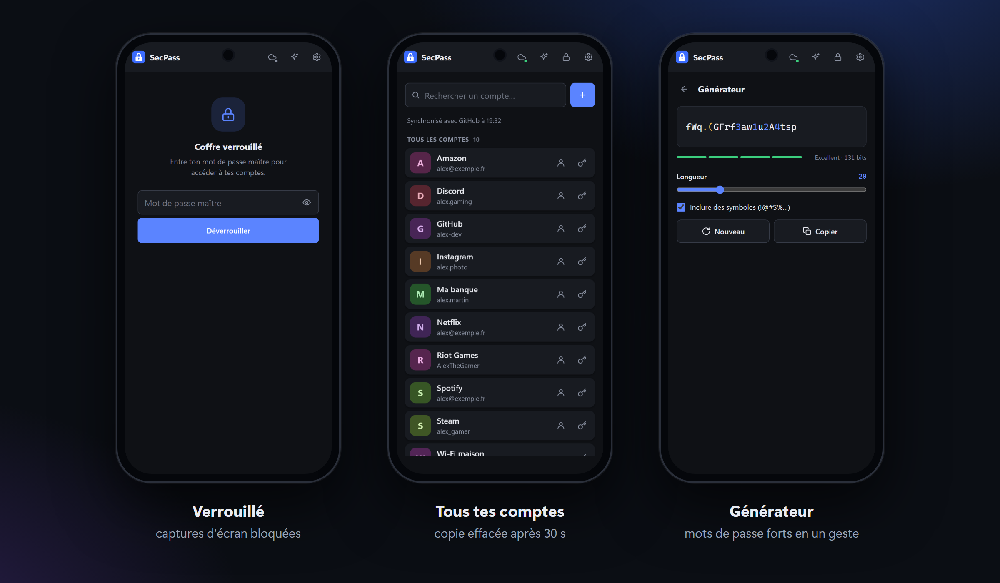
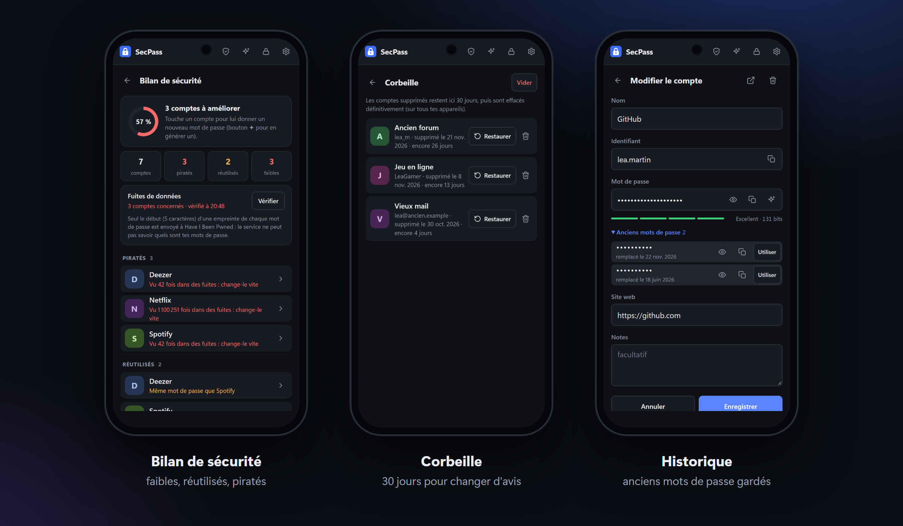

# SecPass pour Android

**Tes mots de passe dans ta poche : chiffrés, ouverts d'un regard, remplis tout seuls.**

### [⬇️ Télécharger la dernière version](https://github.com/KnocklLe/SecPassApp/tree/updates)

Ouvre le lien sur ton téléphone, puis touche le fichier <code>SecPass-x.y.z.apk</code> › <b>Download raw file</b>.

---

  

## ✨ Fonctionnalités

<table>
<tr>
<td width="50%" valign="top">

### 🔓 Ouvrir sans taper
- **Visage, empreinte ou code** du téléphone
- Mot de passe maître redemandé **une fois par semaine** seulement
- Verrouillage auto après 1 min en arrière-plan

### ✍️ Remplir sans copier-coller
- **Remplissage automatique** dans les applis et dans Chrome
- Le bon compte proposé selon l'appli ou le site
- Alerte si un site ne correspond pas au compte (faux site)

</td>
<td width="50%" valign="top">

### 🛡️ Rester en sécurité
- **Bilan de sécurité** : mots de passe faibles, réutilisés ou **piratés**
- **Générateur** de mots de passe forts
- **Corbeille** de 30 jours et **historique** des anciens mots de passe
- Captures d'écran bloquées, copie effacée après 30 s

### 🔄 Partout pareil
- **Synchronisé** avec ton PC et l'extension Chrome via ton dépôt GitHub privé
- Fonctionne **hors ligne**, envoie les modifications plus tard
- **Mises à jour depuis l'appli**, sans câble

</td>
</tr>
</table>

  

Captures faites avec un coffre de démonstration : comptes et mots de passe fictifs.

## 📲 Installation

1. **Télécharge l'APK** sur ton téléphone : [dernière version](https://github.com/KnocklLe/SecPassApp/tree/updates) › `SecPass-x.y.z.apk` › *Download raw file*.
2. **Ouvre le fichier** (notification de téléchargement ou appli *Fichiers*). Android demande d'autoriser ton navigateur à installer des applis : accepte pour cette fois.
3. **Ouvre SecPass**, puis choisis :
   - **Connecter mon dépôt GitHub** pour récupérer ton coffre (dépôt, fichier `vault.json` et jeton d'accès : l'aide est dans l'appli) ;
   - ou **Importer un fichier vault.json**.
4. **Déverrouille** avec ton mot de passe maître. C'est tout.

> [!TIP]
> Ensuite, dans **⚙ Paramètres** :
> - coche **Déverrouillage rapide** pour ouvrir SecPass avec ton visage ou ton empreinte ;
> - touche **Remplissage automatique › Activer** et choisis **SecPass** (voir plus bas).

## ✍️ Remplissage automatique

Quand une appli ou un site te demande de te connecter, Android affiche **« Remplir avec SecPass »** sous le champ. Tu le touches, tu montres ton visage ou ton doigt, et l'identifiant et le mot de passe se remplissent.

**Pour l'activer :**

1. Dans SecPass : **⚙ › Déverrouillage rapide** coché (obligatoire : c'est lui qui protège le remplissage).
2. **⚙ › Remplissage automatique › Activer**, puis choisis **SecPass** dans la liste d'Android.
3. **Dans Chrome** : ⋮ › *Paramètres* › *Services de saisie automatique* › choisis l'option **« saisie automatique avec un autre service »**, puis redémarre Chrome.

<b>Le bouton n'ouvre pas le bon écran ?</b>

 

Sur certains téléphones (Xiaomi / HyperOS, Samsung…), l'écran se trouve ailleurs : ouvre les **Paramètres** d'Android, tape **« saisie automatique »** dans la recherche, puis choisis **SecPass** comme *service de saisie automatique*.

<b>Comment SecPass choisit le compte à proposer ?</b>

 

- **Sur un site** (Chrome, Firefox, Edge, Brave, Samsung Internet…) : d'après l'adresse du site, comparée au champ *Site web* de tes comptes.
- **Dans une appli** : d'après son nom de paquet (`com.instagram.android` ↔ `instagram.com`) pour les applis installées depuis un store, ou d'après le compte que tu as choisi la dernière fois pour cette appli (associé à sa signature : une fausse appli du même nom n'en profite pas).
- Sinon, SecPass t'affiche la liste de tes comptes pour que tu choisisses.

## 🔄 Mises à jour

Dans **⚙ › Mise à jour de l'appli › Rechercher**. SecPass regarde aussi tout seul toutes les 12 h et te prévient.

La nouvelle version est téléchargée depuis ce dépôt, **vérifiée** (empreinte SHA-256 annoncée, nom de l'appli, numéro de version) puis installée après ta confirmation. Android refuse de toute façon une version qui ne serait pas signée avec la même clé que celle installée. **Tes comptes restent sur le téléphone.**

## 🔐 Sécurité

| | |
|---|---|
| **Chiffrement** | AES-256-GCM (toute modification du coffre est détectée), clé dérivée du mot de passe maître avec **scrypt** (N=2¹⁷, r=8, p=1). |
| **Mot de passe maître** | **Jamais enregistré**, nulle part. Il ne quitte jamais le téléphone. |
| **Déverrouillage rapide** | La clé du coffre est gardée par la **puce de sécurité** du téléphone (Android Keystore), utilisable seulement téléphone déverrouillé et après la vérification d'Android. Expire au bout de 7 jours. |
| **Remplissage automatique** | Rien n'est rempli sans ton visage, ton empreinte ou ton code. Le service ne lit qu'une copie **chiffrée** du coffre. |
| **Bilan des fuites** | Seuls les **5 premiers caractères** d'une empreinte SHA-1 de chaque mot de passe sont envoyés à [Have I Been Pwned](https://haveibeenpwned.com/Passwords) : impossible d'en déduire tes mots de passe. Vérification lancée uniquement quand tu touches *Vérifier*. |
| **Écran** | Captures d'écran et aperçu dans les applis récentes **bloqués**. |
| **Presse-papiers** | Copie marquée *sensible* (Android 13+) et **effacée après 30 s**. |
| **Sauvegardes** | Sauvegarde cloud d'Android désactivée : le coffre reste sur le téléphone (et sur ton GitHub privé si tu synchronises). |

<b>Pourquoi ces autorisations ?</b>

 

| Autorisation | À quoi elle sert |
|---|---|
| Internet | Synchroniser avec ton dépôt GitHub privé, chercher les mises à jour, vérifier les fuites (sur demande). |
| Installer des applis | Installer les mises à jour de SecPass (Android demande toujours ta confirmation). |
| Biométrie | Déverrouillage rapide et remplissage automatique (fenêtre d'Android). |
| Service de saisie automatique | Proposer tes comptes dans les autres applis, si tu l'actives. |

Pas de publicité, pas de statistiques, aucun serveur à nous : SecPass ne parle qu'à GitHub et, si tu le demandes, à Have I Been Pwned.

> [!IMPORTANT]
> Ce dépôt est **public** : il ne contient que l'appli (et ses mises à jour), **jamais ton coffre**. Ton `vault.json` reste sur tes appareils et dans **ton** dépôt GitHub **privé**.

## 🧩 Avec le reste de SecPass

L'appli lit et écrit exactement le même `vault.json` que :

- **`mdp.py`**, le gestionnaire en ligne de commande pour PC ;
- **l'extension Chrome** SecPass (panneau latéral, remplissage en un clic).

Un compte ajouté sur l'un apparaît sur les autres. Si deux appareils modifient le même compte, la version la plus récente gagne et l'autre mot de passe part dans l'historique : rien n'est perdu.

## ❓ FAQ

<b>J'ai oublié mon mot de passe maître.</b>

 

Personne ne peut le retrouver, pas même SecPass : c'est ce qui rend ton coffre illisible pour les autres. Garde-le en tête (ou sur papier, en lieu sûr).

<b>Je perds mon téléphone ?</b>

 

Ton coffre y est chiffré et SecPass se verrouille tout seul : sans ton mot de passe maître (ou ton visage / ton empreinte sur ce téléphone déverrouillé), il est illisible. Sur ton nouveau téléphone, installe SecPass et reconnecte ton dépôt GitHub : tout revient. Pense à révoquer l'ancien jeton GitHub et à en créer un nouveau.

<b>Pourquoi l'appli n'est pas sur le Play Store ?</b>

 

C'est un projet personnel. Les mises à jour arrivent directement depuis ce dépôt, vérifiées par l'appli et par Android (même signature obligatoire).

<b>« Remplir avec SecPass » n'apparaît pas.</b>

 

Vérifie que : SecPass est bien le service de saisie automatique choisi dans Android, le déverrouillage rapide est coché (et pas expiré : ouvre SecPass une fois par semaine avec ton mot de passe maître), et, dans Chrome, l'option *saisie automatique avec un autre service* est choisie. Certaines applis bloquent le remplissage automatique : copie alors le mot de passe depuis SecPass (effacé après 30 s).

---

SecPass · AES-256-GCM + scrypt · fait maison 🔐

